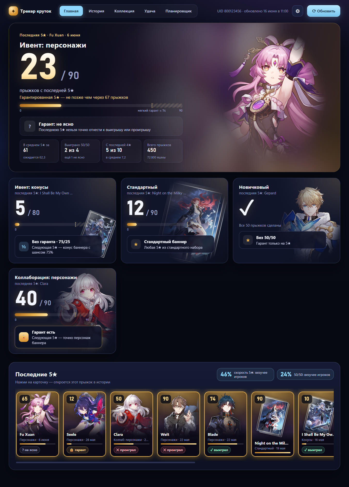
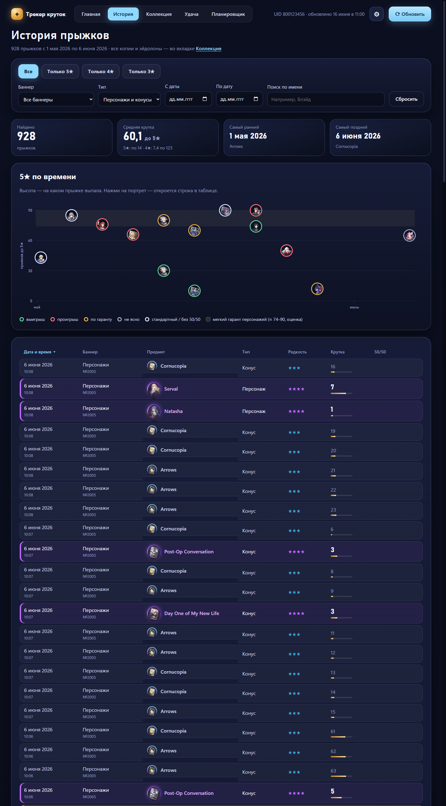
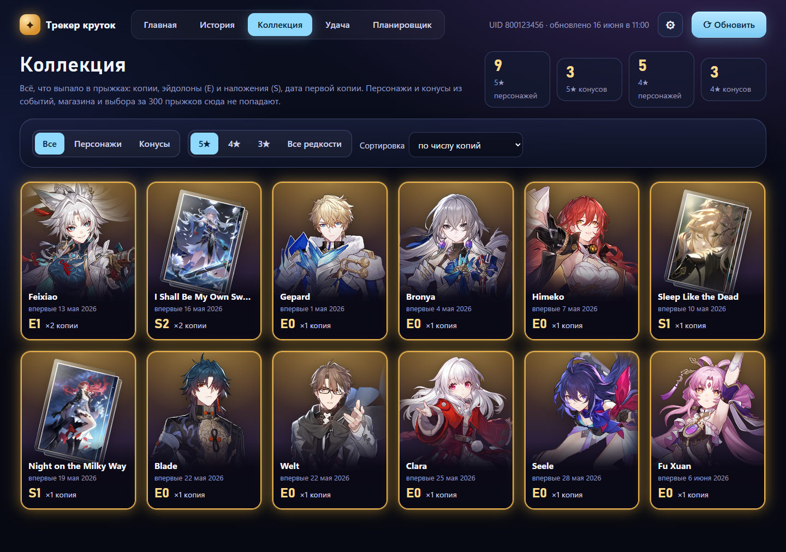
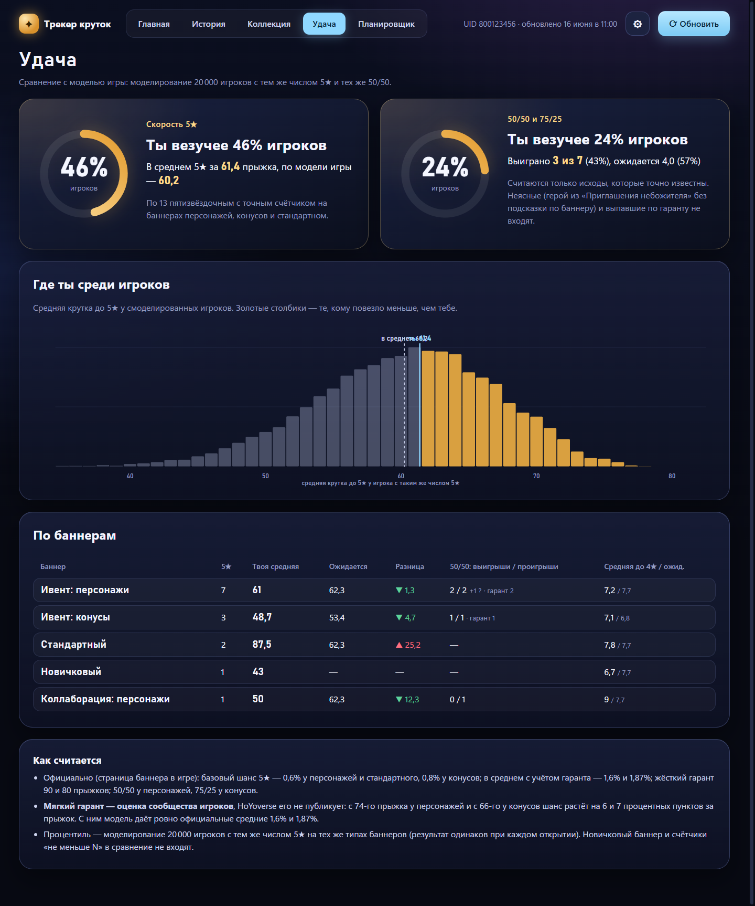
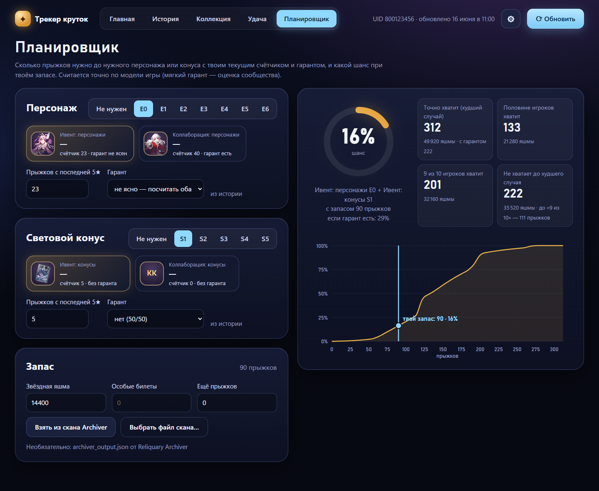

# HSR Warp Tracker

A personal warp (gacha) tracker for **Honkai: Star Rail** — a portable Windows app (Electron) with a Russian interface.
It shows the pity counter and the guarantee of every banner, all your 5★ with the pull they came on and the 50/50
result, a searchable history of every pull, your collection, how lucky you are against the game's model, and a planner
for the next character or light cone.

[Русская версия](README.ru.md)

> **Not affiliated with HoYoverse / COGNOSPHERE.** Honkai: Star Rail, its names and images are trademarks and
> copyrighted material of their owners. This is an unofficial fan tool.



| History | Collection | Luck | Planner |
|---|---|---|---|
|  |  |  |  |

*Screenshots show a synthetic test history (UID 800123456), not a real account.*

## Features

- **One-click update.** Open *Warp → Records* in the game once, then press «Обновить»: the history link is found in the
  game's web cache (files are only read, the game's memory is never touched) and only new pulls are fetched. A link can
  also be pasted by hand.
- **Every banner type the server has.** Known types (character, light cone, standard, departure, collaboration) and any
  new one: types are read from the official history page itself; an unknown type is shown as its own banner.
- **Pity and guarantee** per banner, with the soft-pity zone, and a careful 50/50 resolution: off-banner 5★ are
  certain losses, Celestial Invitation heroes are resolved through the banner run they were pulled on, and anything
  that cannot be known is shown as «не ясно» instead of being guessed. When the stored history does not reach the
  account start, the first 5★ of each banner is shown as a lower bound («≥ N»).
- **History**: every pull with quick filters (all / 5★ / 4★ / 3★), banner, type, period and name search, sorting by any
  column, rows that open the full path to a 5★ / 4★ (pulls since the previous one, what dropped in between, the banner
  run, Stellar Jade spent), a summary of the filter and a 5★ timeline whose portraits jump to their row.
- **Collection**: every character and light cone with copies (eidolons / superimpositions) and the first date.
- **Luck**: your average pull to 5★ and your 50/50 win rate as «luckier than X% of players» — a seeded simulation of
  20 000 players under the game's model — plus a per-banner table.
- **Planner**: pulls needed for the next featured character / light cone (E0–E6, S1–S5) from your current counter and
  guarantee, the exact chance with your Stellar Jade (typed in or read from a Reliquary Archiver scan).
- **Export / import** in the standard formats: SRGF v1.0 and UIGF v4.2.
- **Nothing is lost**: the stored history only grows (the server keeps about a year), a backup is made before every
  write.

## Privacy and security

- The history link contains a personal key (`authkey`, valid for about a day). It is sent **only** to the official
  HoYoverse warp history API (`public-operation-hkrpg-sg.hoyoverse.com` / `public-operation-hkrpg.mihoyo.com`), with a
  pause of at least 0.3 s between requests. It is kept in memory only: never written to the history, settings, logs,
  exports or the HTTP cache (the requests use an in-memory session without a cache; tests check every file of the
  profile for the key).
- The only other network access is downloading character and light cone images from the public
  [StarRailRes](https://github.com/Mar-7th/StarRailRes) repository on GitHub, by game id, for the items in your history.
  No telemetry, no accounts, no other servers.
- All data stays in the `userdata` folder next to the program.

## The model

Official (shown on the in-game banner page): 5★ base rate 0.6% (characters, standard) / 0.8% (light cones), 1.6% /
1.87% consolidated, hard pity 90 / 80, 50/50 for characters and 75/25 for light cones. **The soft pity is a community
estimate** (not published by HoYoverse): from pull 74 / 66 the 5★ chance grows by 6 / 7 percentage points per pull. With
it the model reproduces the official consolidated rates exactly. Every screen that relies on it says so.

## Download and use

Take the ZIP from the Releases page, unpack it anywhere and run `HSR Warp Tracker.exe` — no installation. Windows x64.

## Build from source

Requirements: Windows x64, Node.js 20+, Python 3.10+.

```bash
python scripts/install_electron.py        # pinned Electron 44.5.1, checked against its SHA-256
npm test                                  # core, tracker and art tests (Node)
.build-tools/electron/electron.exe scripts/test_ui_electron.cjs   # UI test with a fake server
.build-tools/electron/electron.exe app    # run from source
python scripts/package_app.py && python scripts/zip_release.py    # dist/HSR Warp Tracker + ZIP
```

## Third-party content

- Character and light cone images are **not included** in this repository or in the releases. The app downloads them
  at run time, on demand, from [Mar-7th/StarRailRes](https://github.com/Mar-7th/StarRailRes) (a repository published
  under AGPL-3.0; the images themselves are game assets © HoYoverse). They are cached locally in `userdata/art`.
- Release builds contain [Electron](https://www.electronjs.org/) (MIT) and its bundled components.

## License

[MIT](LICENSE) for the code of this repository.
