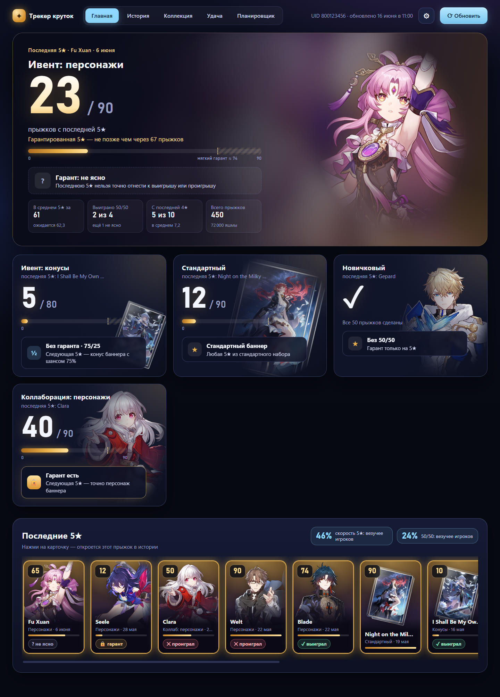
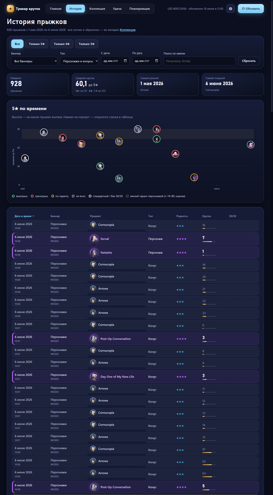
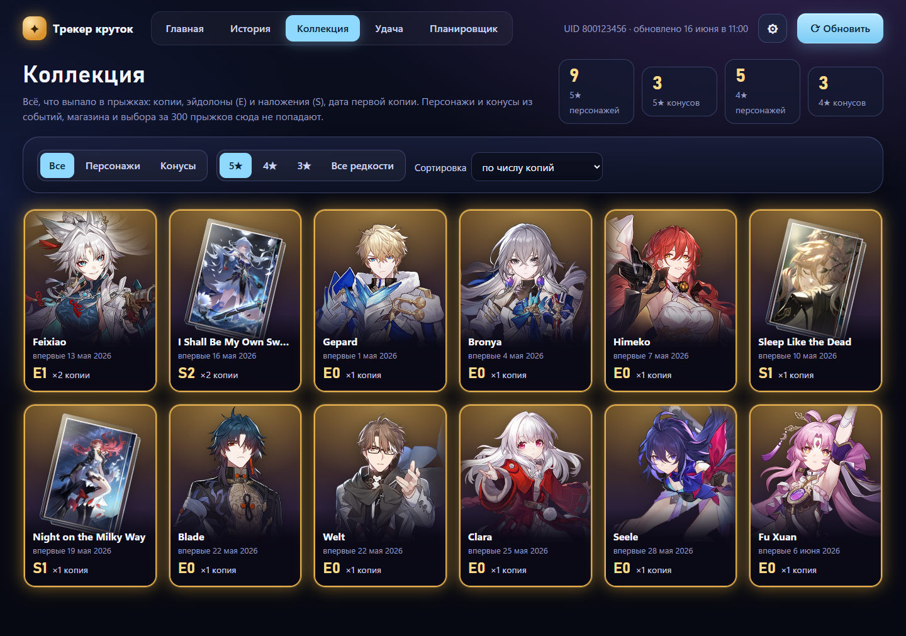
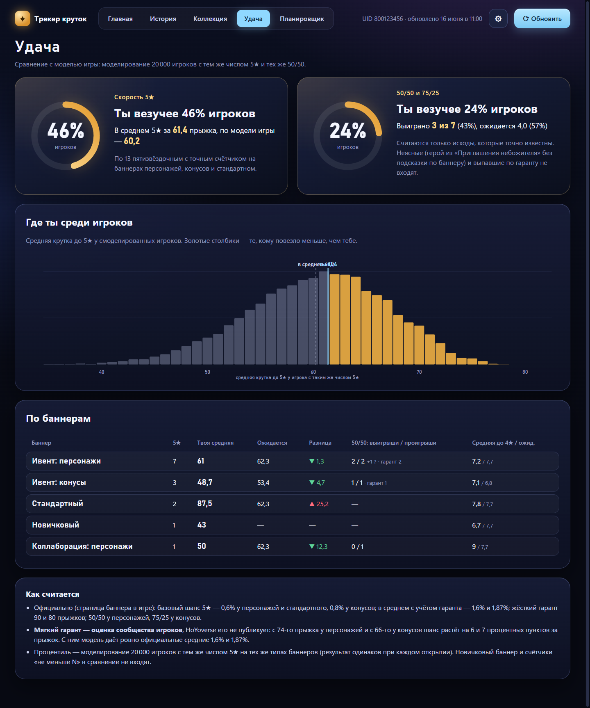
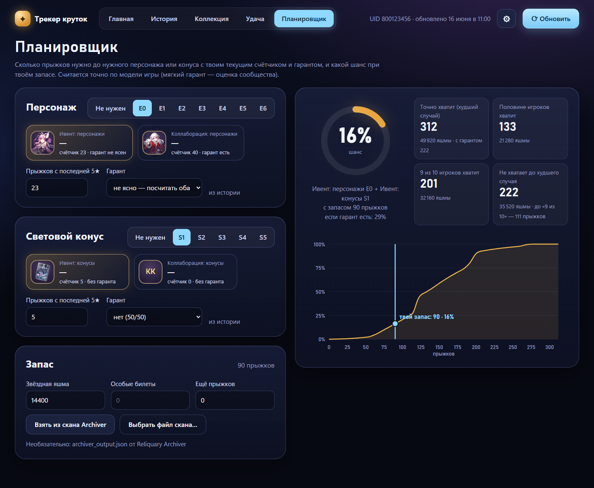

# HSR Warp Tracker — трекер круток

Личный трекер прыжков для **Honkai: Star Rail** — переносимая программа для Windows (Electron) с русским
интерфейсом. Показывает счётчик гаранта и гарант на каждом баннере, все 5★ с номером прыжка и исходом 50/50, всю
историю прыжков с поиском, коллекцию, твою удачу в сравнении с моделью игры и планировщик следующего персонажа или
конуса.

[English version](README.md)

> **Не связано с HoYoverse / COGNOSPHERE.** Honkai: Star Rail, названия и изображения из игры принадлежат их
> правообладателям. Это неофициальная фанатская программа.



| История | Коллекция | Удача | Планировщик |
|---|---|---|---|
|  |  |  |  |

*На скриншотах синтетическая тестовая история (UID 800123456), а не настоящий аккаунт.*

## Возможности

- **Обновление в один клик.** Один раз открой в игре *Прыжки → История прыжков* и нажми «Обновить»: ссылка на историю
  найдётся в кэше игры (файлы только читаются, память игры не трогается), загрузятся только новые прыжки. Ссылку можно
  вставить и вручную.
- **Все типы баннеров, которые отдаёт сервер.** Известные (персонажи, конусы, стандартный, новичковый, коллаборация) и
  любые новые: список типов берётся из самой официальной страницы истории, неизвестный тип показывается отдельным
  баннером.
- **Гарант** на каждом баннере с зоной мягкого гаранта и аккуратный разбор 50/50: стандартные 5★ — точный проигрыш,
  герои «Приглашения небожителя» разбираются по запуску баннера, на котором выпали, а то, что узнать нельзя, честно
  помечается «не ясно». Если сохранённая история не доходит до начала аккаунта, первая 5★ каждого баннера показана
  как нижняя граница («≥ N»).
- **История**: все прыжки, быстрые фильтры (все / 5★ / 4★ / 3★), баннер, тип, период и поиск по имени, сортировка по
  любой колонке, раскрытие строки — весь путь до этой 5★ / 4★ (сколько прыжков, что выпало между ними, запуск баннера,
  сколько ушло яшмы), сводка по фильтру и график 5★ по времени с переходом к строке.
- **Коллекция**: все персонажи и конусы с копиями (эйдолоны / наложения) и датой первого получения.
- **Удача**: средняя крутка до 5★ и процент выигранных 50/50 как «везучее X% игроков» — моделирование 20 000 игроков по
  модели игры — и таблица по баннерам.
- **Планировщик**: сколько прыжков до нужного персонажа / конуса (E0–E6, S1–S5) с текущим счётчиком и гарантом и точный
  шанс при твоём запасе звёздной яшмы (вручную или из скана Reliquary Archiver).
- **Экспорт и импорт** в стандартных форматах SRGF v1.0 и UIGF v4.2.
- **Ничего не теряется**: сохранённая история только дописывается (сервер хранит примерно год), перед каждой записью —
  резервная копия.

## Приватность и безопасность

- В ссылке на историю есть личный ключ (`authkey`, живёт около суток). Он отправляется **только** на официальный сервер
  истории прыжков HoYoverse (`public-operation-hkrpg-sg.hoyoverse.com` / `public-operation-hkrpg.mihoyo.com`), с паузой
  не меньше 0,3 с между запросами. Ключ хранится только в памяти: не пишется ни в историю, ни в настройки, ни в лог, ни
  в экспорт, ни в HTTP-кэш (запросы идут через сессию в памяти без кэша; тесты проверяют каждый файл профиля).
- Кроме этого программа только скачивает картинки героев и конусов из открытого репозитория
  [StarRailRes](https://github.com/Mar-7th/StarRailRes) на GitHub — по игровому ID и только для того, что есть в твоей
  истории. Никакой телеметрии, аккаунтов и других серверов.
- Все данные лежат в папке `userdata` рядом с программой.

## Модель

Официально (страница баннера в игре): базовый шанс 5★ — 0,6% (персонажи, стандартный) / 0,8% (конусы), в среднем 1,6% /
1,87%, жёсткий гарант 90 / 80, 50/50 у персонажей и 75/25 у конусов. **Мягкий гарант — оценка сообщества игроков**
(HoYoverse его не публикует): с 74-го / 66-го прыжка шанс растёт на 6 / 7 процентных пунктов за прыжок. С ней модель
даёт ровно официальные средние шансы. Каждый экран, который на неё опирается, об этом пишет.

## Как скачать и пользоваться

Возьми ZIP на странице Releases, распакуй в любую папку и запусти `HSR Warp Tracker.exe` — установка не нужна.
Windows x64.

## Сборка из исходников

Нужны Windows x64, Node.js 20+, Python 3.10+.

```bash
python scripts/install_electron.py        # Electron 44.5.1 с проверкой SHA-256
npm test                                  # тесты ядра, трекера и картинок (Node)
.build-tools/electron/electron.exe scripts/test_ui_electron.cjs   # тест интерфейса с поддельным сервером
.build-tools/electron/electron.exe app    # запуск из исходников
python scripts/package_app.py && python scripts/zip_release.py    # dist/HSR Warp Tracker + ZIP
```

## Сторонние материалы

- Картинок героев и конусов **нет** ни в репозитории, ни в релизах. Программа скачивает их во время работы, по мере
  надобности, из [Mar-7th/StarRailRes](https://github.com/Mar-7th/StarRailRes) (репозиторий опубликован под AGPL-3.0;
  сами изображения — игровые материалы © HoYoverse) и хранит в `userdata/art`.
- Сборки содержат [Electron](https://www.electronjs.org/) (MIT) и его компоненты.

## Лицензия

[MIT](LICENSE) — для кода этого репозитория.
